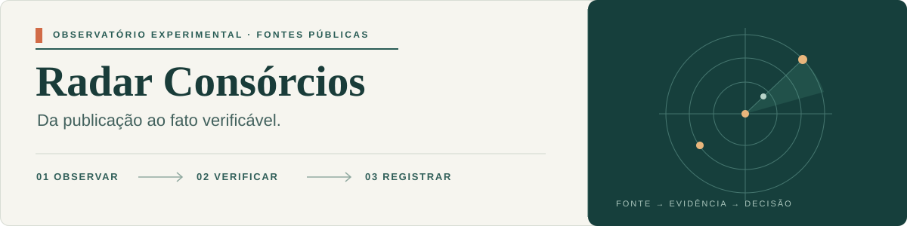
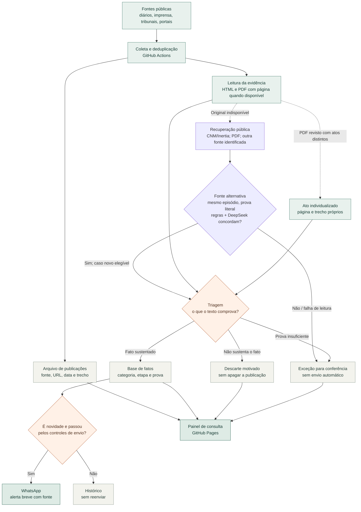

<p align="center">
  
</p>

# Radar Consórcios

**Um radar de publicações sobre consórcios intermunicipais que guarda a fonte, explica a decisão e só então considera um alerta.** O piloto apoia a pesquisa sobre coordenação federativa por consórcios intermunicipais desenvolvida no Ipea.

[Abrir o painel público](https://driano1221.github.io/radar-consorcios-whatsapp/) · [Explorar a base](data/catalogo/README.md) · [Entender o painel](dashboard/README.md) · [Ler a memória do projeto](docs/MEMORIA_DO_PROJETO.md)

O fluxo principal é **notícia → triagem com prova → confirmada ou rejeitada → WhatsApp quando elegível**. Casos inconclusivos ficam em **Revisar comigo**. As sete categorias são Criação, Adesão, Saída, Rateio, Protocolo, Crise e Atuação; esta última mantém os subtipos Governança, Finanças e Controle/Fiscalização. Controle permanece só no painel.

O painel tem uma **base principal de notícias**, com data, consórcio/UF, classificação e etapa, decisão e situação no WhatsApp sempre visíveis. A mesma lista pode ser baixada em [CSV](https://driano1221.github.io/radar-consorcios-whatsapp/noticias.csv); as tabelas de apoio ficam em Dados técnicos.

Das 39 exceções da triagem inicial, **22 foram confirmadas, 12 rejeitadas, quatro vinculadas a registros principais e uma continua em Revisar comigo**. [Decisões, fontes e a pendência do caso 31](docs/REVISAO-CONJUNTA-39-2026-10-21.md). A fotografia do acervo tem **186 confirmadas, 2.667 rejeitadas e uma em revisão**. Nenhuma decisão desse lote libera alerta ou resumo retroativo. [Política e reprodução offline](docs/TRIAGEM_AUTOMATICA.md).

[](https://github.com/driano1221/radar-consorcios-whatsapp/actions/workflows/radar.yml) [](https://github.com/driano1221/radar-consorcios-whatsapp/actions/workflows/publish-dashboard.yml)

> [!IMPORTANT]
> Este é um instrumento experimental de pesquisa, **não** um cadastro oficial de consórcios ou de municípios consorciados, nem uma base homologada pelo Ipea. Uma lei que autoriza ingresso não comprova, sozinha, que a adesão foi efetivada.

## A ideia central

O mesmo texto pode conter uma notícia útil, uma simples menção ou vários atos diferentes. Por isso, o Radar separa três perguntas que não devem ser confundidas:

| Pergunta | Resposta registrada |
| --- | --- |
| O que foi encontrado? | A publicação original, mesmo que depois seja descartada. |
| O que o texto realmente comprova? | Um fato aceito, um descarte justificado ou uma exceção temporária para conferência, com trecho e fonte. |
| Isso deve chegar ao WhatsApp agora? | Uma decisão independente, que considera data, novidade, duplicidade, limites e revisão. |

Exemplo real: uma [edição do Diário Oficial de Joinville](https://data.queridodiario.ok.org.br/4209102/2026-10-09/e724cedc98aef3a88dc6f167373c355c0d837af4.pdf) contém uma compra municipal na página 95 e um apostilamento de contrato de rateio nas páginas 159–160. A edição permanece **uma publicação** no arquivo, mas os dois atos têm decisões próprias: compra fora da base de fatos e rateio confirmado. A edição inteira não vira alerta. A separação por atos é, por enquanto, uma revisão editorial assistida, não uma detecção automática garantida em todos os PDFs.

## Do sinal ao fato



O fluxo tem **dois destinos independentes**: a base histórica e o envio ao WhatsApp. Um fato pode estar confirmado na base e ser antigo demais para virar mensagem. O [fluxograma detalhado do painel](https://driano1221.github.io/radar-consorcios-whatsapp/) mostra também as verificações de novidade, fila e revisão por IA.

Desde 14/10/2026, a AMM-MT está habilitada para alertas, mantendo a revisão por IA. Um corte de ativação bloqueia publicações anteriores e datas não verificáveis, inclusive na fila: habilitar uma fonte não libera seu acervo antigo. Textos fornecidos manualmente são identificados como tal, sem simular sucesso do coletor.

**Leitura e fontes (19/10):** páginas SVG da AMM-MT têm leitor próprio, com texto e localização por página; publicações recuperadas anteriores a 20/10 ficam sem alerta retroativo. O radar reutiliza íntegras verificadas, a revisão recebe o corpo dos artigos e a recuperação procura reproduções públicas da CNM/Araguaia com autoria separada. A indisponibilidade externa do Querido Diário permanece explícita. [Correções, testes e limites](docs/CORRECAO-FONTES-IA-2026-10-19.md).

**Querido Diário (19/10):** cliente migrado para `api.queridodiario.org.br`, confirmado pela configuração pública oficial. Os 447 testes passaram no Actions, mas a API atual continua retornando 503; os PDFs históricos acessíveis não substituem a busca. [Diagnóstico real e acompanhamento do incidente oficial](docs/DIAGNOSTICO-QUERIDO-DIARIO-2026-10-19.md).

**Coleta independente (19/10):** integração de matérias oficiais em HTML dos diários de MG, AL, PR e RN e exportações oficiais do CIGA/SC via CKAN. Textos completos, códigos, datas e proveniência passam pelo fluxo de triagem existente; isso não é um espelho nacional do Querido Diário. RNCP segue na descoberta Google: seu leitor foi corrigido, mas Cloudflare ainda bloqueia o Actions. Fontes novas têm corte de alertas em **20/10, 00h de Brasília**, sem liberar o histórico. [Fontes, testes e limites](docs/ALTERNATIVAS-DIARIOS-RNCP-2026-10-19.md).

## Onde os dados ficam

**Recuperação de texto é independente da decisão.** A rotina diária de recuperação também pode completar documentos já revisados ou enviados, sem reenviá-los. Erros temporários recebem uma segunda tentativa; falhas persistentes voltam à fila com intervalo crescente (12 horas até 7 dias). Cada passagem tem limite de tempo e de itens por fonte. CAPTCHA real não é contornado: uma recuperação assistida fica identificada como tal. O workflow verifica que IDs, revisões e estado de envios não foram alterados.

| Camada | O que representa | Onde consultar |
| --- | --- | --- |
| Publicações | Uma linha por URL arquivada, inclusive descartes. | [Arquivo de coletas](data/catalogo/arquivo-coletas.ndjson) |
| Atos | Fatos ou descartes individualizados dentro de uma edição extensa. | [Atos identificados](data/catalogo/atos-identificados.ndjson) · [tabela](data/catalogo/atos.csv) |
| Fatos | Eventos relacionados a consórcios, com etapa, fonte e decisão editorial quando houver. | [Eventos](data/catalogo/eventos.csv) |
| Identidades | Consórcios mencionados e vínculos documentais; não são filiação comprovada. | [Consórcios](data/catalogo/consorcios.csv) · [vínculos](data/catalogo/vinculos-documentos.csv) |
| Participações | Relações município–consórcio sustentadas por documento revisado, com ano quando comprovado. | [Participações](data/catalogo/participacoes.csv) |

O [painel](https://driano1221.github.io/radar-consorcios-whatsapp/) reúne essas camadas em linguagem de consulta, com justificativas, trechos, páginas de PDF, estatísticas e filtros. Ele é **público e somente de leitura**. O pacote público não inclui os textos integrais recuperados; sua atualização depende de uma coleta persistida e do deploy do GitHub Pages, não é transmissão em tempo real.

## Coleta, revisão e publicação

**Estado da automação (16/10):** as regras de atuação realizada, composição documentada, protocolo assinado e convocação futura já valem para novas leituras. Isso **não** equivale a confirmar automaticamente todo texto original na base: a política experimental para originais foi testada em branch separada (80/82 no último teste) e **não foi ativada**. A decisão automática por fonte alternativa já existe, com concordância entre regras e IA, prova literal e proteção das revisões históricas. [Fluxo vigente e próximos passos](docs/TRIAGEM_AUTOMATICA.md).

**Revisão documental aplicada (16/10):** Divinópolis foi atualizado com a Lei 9.770/2026; uma notícia do TCE-MG foi separada em três acórdãos. O painel preserva notícia, provas por página e a divergência CONSANE (1217068 na notícia / 1217968 no acórdão), sem tratar o vínculo editorial como errata oficial. O lote é histórico, idempotente e bloqueado para alerta e resumo semanal: **1.982 publicações preservadas, 119 fatos confirmados e 10 atos individualizados**. [Antes/depois e documentos](docs/VALIDACAO-DIVINOPOLIS-TCEMG-2026-10-16.md) · [424 testes aprovados no Actions](https://github.com/driano1221/radar-consorcios-whatsapp/actions/runs/38970681230).

**CNM:** leitor de íntegra e recuperação alternativa aplicados; descoberta continua pelo Google Notícias. O coletor direto foi preparado e testado, mas a listagem respondeu **403 no GitHub Actions** e permanece desativada. A listagem contém resumos truncados; só o conteúdo da página individual validada é íntegra. Alertas CNM exigem data original a partir de **17/10/2026**, além dos controles usuais; não se libera o acervo anterior. A recuperação pode buscar Conclima e outras reproduções públicas, sem trocar a autoria do original nem presumir acesso universal.

**Textos alternativos na triagem:** novas publicações podem ser aceitas ou descartadas com base em outro veículo quando regras e DeepSeek concordam sobre o mesmo episódio e a prova literal. O painel distingue original, fonte usada e motivo; duplicatas não viram outro fato. Históricos e revisões humanas são preservados, e a recuperação não libera envios. [Funcionamento e limites](data/catalogo/README.md#decisão-por-fonte-alternativa).

- **Fontes:** Google News, Querido Diário, RSS, CIGA, SAPL e portais oficiais. Cada conector funciona isoladamente; fontes em prévia ou bloqueadas não são liberadas para envio só por aparecerem na busca. A [configuração vigente](config/default.json) é a referência para a lista exata.
- **Rotas alternativas (16/10):** RSS público do Semana 7 e exportação JSON do PortalTP da Prefeitura de Guanhães integrados para descobrir documentos novos. Só títulos/ementas relacionados a consórcios, posteriores à ativação e com URL ainda ausente do acervo entram por essas rotas. Alertas continuam bloqueados, inclusive no boletim, até homologação da leitura integral. RSS não contém corpo completo; PortalTP cobre decretos da Prefeitura, não todas as leis da Câmara. Sitemap bloqueado e APIs vazias não foram ativados. O workflow manual [Testar rotas públicas sem envios](.github/workflows/test-public-routes.yml) exercita os coletores sem credenciais de WhatsApp nem alteração da base.
- **Recuperação complementar:** a rotina diária `recuperar-textos.yml` lê até dois documentos pendentes dessas rotas por passagem. PDFs oficiais de Guanhães recebem extração por página e OCR português seletivo; só uma leitura sem páginas pendentes entra no armazenamento de textos integrais. Para Semana 7, procura publicações compatíveis no acervo, no Google Notícias e na API pública da Rede da Notícia. Textos de outros veículos são guardados separadamente, com URL, hash, data, limitações e eventual atribuição ao Semana 7 — nunca são apresentados como texto recuperado do site bloqueado nem como confirmação independente. Nada disso, sozinho, muda decisões ou libera WhatsApp. [Detalhes dos arquivos](data/catalogo/README.md#recuperação-complementar-de-fontes-públicas).
- **Leitura:** páginas HTML podem ser comparadas por Readability e Trafilatura. PDFs são recuperados seletivamente, com trechos atribuídos à página quando a extração permite. Um título sozinho não prova o fato.
- **Regras e IA:** a classificação determinística distingue, por exemplo, proposta, autorização e ingresso efetivo. O DeepSeek pode fazer uma segunda leitura quando habilitado, exigindo evidência literal; falha ou resposta inconsistente não libera o envio. A IA não cria fonte nem substitui a revisão documental.
- **Alertas:** o workflow solicita uma coleta a cada duas horas, no minuto 17 de Brasília. O GitHub Actions pode atrasar ou omitir uma execução. Havendo itens elegíveis, o limite configurado é de até três mensagens por rodada e 72 por dia; a fila persiste por até 30 dias.
- **Resumo semanal:** sábado às 9h de Brasília, com tentativa às 12h apenas se a edição ainda não tiver entrega confirmada. A janela vai de sábado às 9h até o sábado seguinte às 9h (fim exclusivo). Fatos confirmados são selecionados pela publicação original, independentemente do bloqueio de reenvio individual; duplicatas e fatos históricos de meses anteriores continuam fora. A prévia reconstruída nunca substitui recibos nem dispara edições antigas. [Regra e validação](docs/CORRECAO-ACTIONS-RESUMO-2026-10-19.md).
- **Preferência de canal (19/10):** Controle/Fiscalização permanece na base e no painel, mas não é enviado em alertas nem resumos do WhatsApp. As demais categorias seguem seus critérios de evidência, data e deduplicação. Acompanhamento técnico classificado como Atuação não é excluído apenas por citar fiscalização.
- **Painel:** um push ao `main` ou uma execução que persista novos dados reconstrói o site. Uma aba aberta procura nova versão a cada cinco minutos.

O envio usa [Baileys](https://github.com/WhiskeySockets/Baileys) sobre WhatsApp Web, **não** a API oficial da Meta. A sessão fica cifrada; senha, ID dos grupos, telefone pessoal e arquivos locais de pareamento não devem entrar no repositório. Veja [operação segura e recuperação](docs/OPERACAO.md).

## Explorar localmente

Requisitos: Node.js 22, npm e Git. Para abrir o painel sem enviar mensagens:

```sh
npm ci
npm test
npm run dashboard:build
npm run dashboard:serve
```

Acesse `http://127.0.0.1:4173/`. Para testar o pacote que vai ao Pages, execute `npm run dashboard:build:public` e `node scripts/check-public-dashboard.mjs`.

| Pasta ou arquivo | Papel |
| --- | --- |
| [`src/radar.mjs`](src/radar.mjs) | Orquestra coleta, triagem, fila e alerta. |
| [`src/lib/`](src/lib/) | Leitores, classificador, identidades, deduplicação e proteção editorial. |
| [`data/catalogo/`](data/catalogo/) | Publicações, atos, revisões, fatos e relações derivadas. |
| [`dashboard/`](dashboard/) | Interface estática e visualização pública. |
| [`.github/workflows/`](.github/workflows/) | Coleta, resumo, recuperação, testes e publicação. |

## O que ainda precisa melhorar

1. Identificar automaticamente os limites entre atos em novos PDFs **sem** atribuir a prova da página errada ao evento.
2. Implementar e validar a confirmação automática de textos originais completos, hoje ainda distinta da classificação e da decisão automática por fonte alternativa. Recuperar texto e resolver discordâncias antes de decidir; não zerar indicadores trocando rótulos.
3. Ampliar e auditar identidades, CNPJ e relações município–consórcio antes de usar a base como cadastro histórico confiável.

Decisões, incidentes e limites ficam na [memória do projeto](docs/MEMORIA_DO_PROJETO.md). A [revisão dos coletores de 20/10](docs/SAUDE-COLETORES-2026-10-20.md) distingue a indisponibilidade do Querido Diário, bloqueios de páginas e cobertura parcial por paginação. Para detalhes técnicos, consulte a [arquitetura](docs/ARQUITETURA.md), o [guia da base](data/catalogo/README.md) e a [documentação do painel](dashboard/README.md).

### Triagem: revisão humana como exceção

A manutenção de 22/10 corrigiu a reabertura de rejeições e reprocessou os 310 registros: resultado inicial de 24 confirmados, 281 rejeitados, 2 conflitos documentais e 3 leituras pendentes do bot. Os dois conflitos foram depois classificados por inferência autorizada, com ressalvas. A leitura manual dos casos 3–13 resolveu outros 11 processamentos, com 2 confirmações e 9 rejeições; restam 14 processamentos na base de 3.113 registros. A fila técnica aparece separada em **Em processamento automático**. As sete famílias e as decisões humanas continuam preservadas. [Resultado atual, limites e reprodução](docs/REPROCESSAMENTO-310-2026-10-22.md). Novos ajustes devem melhorar regras e testes reutilizáveis, mantendo os bloqueios de alerta/resumo do acervo.
