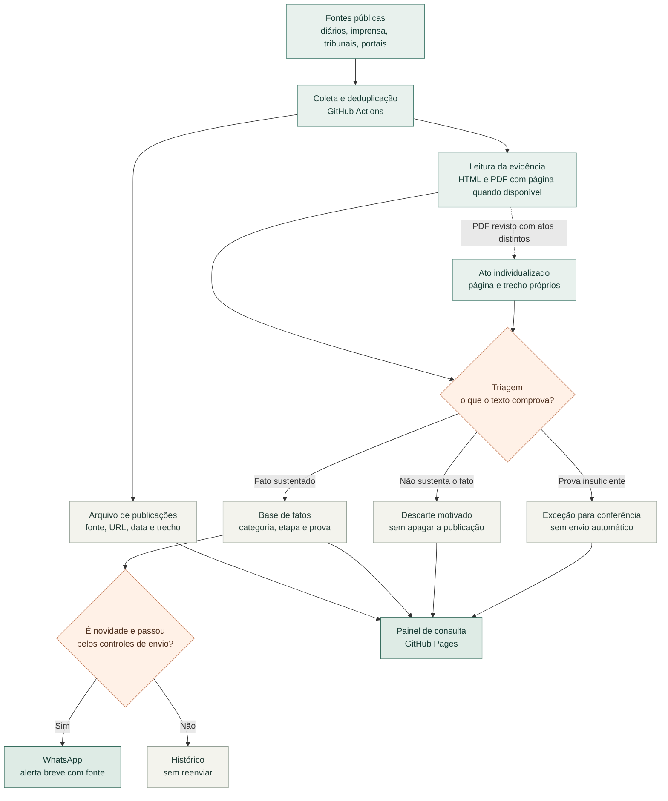

<p align="center">
  
</p>

# Radar Consórcios

**Um radar de publicações sobre consórcios intermunicipais que guarda a fonte, explica a decisão e só então considera um alerta.** O piloto apoia a pesquisa sobre coordenação federativa por consórcios intermunicipais desenvolvida no Ipea.

[Abrir o painel público](https://driano1221.github.io/radar-consorcios-whatsapp/) · [Explorar a base](data/catalogo/README.md) · [Entender o painel](dashboard/README.md) · [Ler a memória do projeto](docs/MEMORIA_DO_PROJETO.md)

[](https://github.com/driano1221/radar-consorcios-whatsapp/actions/workflows/radar.yml) [](https://github.com/driano1221/radar-consorcios-whatsapp/actions/workflows/publish-dashboard.yml)

> [!IMPORTANT]
> Este é um instrumento experimental de pesquisa, **não** um cadastro oficial de consórcios ou de municípios consorciados, nem uma base homologada pelo Ipea. Uma lei que autoriza ingresso não comprova, sozinha, que a adesão foi efetivada.

## A ideia central

O mesmo texto pode conter uma notícia útil, uma simples menção ou vários atos diferentes. Por isso, o Radar separa três perguntas que não devem ser confundidas:

| Pergunta | Resposta registrada |
| --- | --- |
| O que foi encontrado? | A publicação original, mesmo que depois seja descartada. |
| O que o texto realmente comprova? | Um fato aceito, um descarte justificado ou uma exceção temporária para conferência, com trecho e fonte. |
| Isso deve chegar ao WhatsApp agora? | Uma decisão independente, que considera data, novidade, duplicidade, limites e revisão. |

Exemplo real: uma [edição do Diário Oficial de Joinville](https://data.queridodiario.ok.org.br/4209102/2026-10-09/e724cedc98aef3a88dc6f167373c355c0d837af4.pdf) contém uma compra municipal na página 95 e um apostilamento de contrato de rateio nas páginas 159–160. A edição permanece **uma publicação** no arquivo, mas os dois atos têm decisões próprias: compra fora da base de fatos e rateio confirmado. A edição inteira não vira alerta. A separação por atos é, por enquanto, uma revisão editorial assistida, não uma detecção automática garantida em todos os PDFs.

## Do sinal ao fato



O fluxo tem **dois destinos independentes**: a base histórica e o envio ao WhatsApp. Um fato pode estar confirmado na base e ser antigo demais para virar mensagem. O [fluxograma detalhado do painel](https://driano1221.github.io/radar-consorcios-whatsapp/) mostra também as verificações de novidade, fila e revisão por IA.

Desde 14/10/2026, a AMM-MT está habilitada para alertas, mantendo a revisão por IA. Um corte de ativação bloqueia publicações anteriores e datas não verificáveis, inclusive na fila: habilitar uma fonte não libera seu acervo antigo. Textos fornecidos manualmente são identificados como tal, sem simular sucesso do coletor.

## Onde os dados ficam

**Recuperação de texto é independente da decisão.** A rotina diária de recuperação também pode completar documentos já revisados ou enviados, sem reenviá-los. Erros temporários recebem uma segunda tentativa; falhas persistentes voltam à fila com intervalo crescente (12 horas até 7 dias). Cada passagem tem limite de tempo e de itens por fonte. CAPTCHA real não é contornado: uma recuperação assistida fica identificada como tal. O workflow verifica que IDs, revisões e estado de envios não foram alterados.

| Camada | O que representa | Onde consultar |
| --- | --- | --- |
| Publicações | Uma linha por URL arquivada, inclusive descartes. | [Arquivo de coletas](data/catalogo/arquivo-coletas.ndjson) |
| Atos | Fatos ou descartes individualizados dentro de uma edição extensa. | [Atos identificados](data/catalogo/atos-identificados.ndjson) · [tabela](data/catalogo/atos.csv) |
| Fatos | Eventos relacionados a consórcios, com etapa, fonte e decisão editorial quando houver. | [Eventos](data/catalogo/eventos.csv) |
| Identidades | Consórcios mencionados e vínculos documentais; não são filiação comprovada. | [Consórcios](data/catalogo/consorcios.csv) · [vínculos](data/catalogo/vinculos-documentos.csv) |
| Participações | Relações município–consórcio sustentadas por documento revisado, com ano quando comprovado. | [Participações](data/catalogo/participacoes.csv) |

O [painel](https://driano1221.github.io/radar-consorcios-whatsapp/) reúne essas camadas em linguagem de consulta, com justificativas, trechos, páginas de PDF, estatísticas e filtros. Ele é **público e somente de leitura**. O pacote público não inclui os textos integrais recuperados; sua atualização depende de uma coleta persistida e do deploy do GitHub Pages, não é transmissão em tempo real.

## Coleta, revisão e publicação

- **Fontes:** Google News, Querido Diário, RSS, CIGA, SAPL e portais oficiais. Cada conector funciona isoladamente; fontes em prévia ou bloqueadas não são liberadas para envio só por aparecerem na busca. A [configuração vigente](config/default.json) é a referência para a lista exata.
- **Leitura:** páginas HTML podem ser comparadas por Readability e Trafilatura. PDFs são recuperados seletivamente, com trechos atribuídos à página quando a extração permite. Um título sozinho não prova o fato.
- **Regras e IA:** a classificação determinística distingue, por exemplo, proposta, autorização e ingresso efetivo. O DeepSeek pode fazer uma segunda leitura quando habilitado, exigindo evidência literal; falha ou resposta inconsistente não libera o envio. A IA não cria fonte nem substitui a revisão documental.
- **Alertas:** o workflow solicita uma coleta a cada duas horas, no minuto 17 de Brasília. O GitHub Actions pode atrasar ou omitir uma execução. Havendo itens elegíveis, o limite configurado é de até três mensagens por rodada e 72 por dia; a fila persiste por até 30 dias.
- **Resumo semanal:** sábado às 9h de Brasília, com tentativa às 12h apenas se a edição ainda não tiver entrega confirmada. O destino semanal pode ser configurado separadamente; a operação atual permanece em homologação.
- **Painel:** um push ao `main` ou uma execução que persista novos dados reconstrói o site. Uma aba aberta procura nova versão a cada cinco minutos.

O envio usa [Baileys](https://github.com/WhiskeySockets/Baileys) sobre WhatsApp Web, **não** a API oficial da Meta. A sessão fica cifrada; senha, ID dos grupos, telefone pessoal e arquivos locais de pareamento não devem entrar no repositório. Veja [operação segura e recuperação](docs/OPERACAO.md).

## Explorar localmente

Requisitos: Node.js 22, npm e Git. Para abrir o painel sem enviar mensagens:

```sh
npm ci
npm test
npm run dashboard:build
npm run dashboard:serve
```

Acesse `http://127.0.0.1:4173/`. Para testar o pacote que vai ao Pages, execute `npm run dashboard:build:public` e `node scripts/check-public-dashboard.mjs`.

| Pasta ou arquivo | Papel |
| --- | --- |
| [`src/radar.mjs`](src/radar.mjs) | Orquestra coleta, triagem, fila e alerta. |
| [`src/lib/`](src/lib/) | Leitores, classificador, identidades, deduplicação e proteção editorial. |
| [`data/catalogo/`](data/catalogo/) | Publicações, atos, revisões, fatos e relações derivadas. |
| [`dashboard/`](dashboard/) | Interface estática e visualização pública. |
| [`.github/workflows/`](.github/workflows/) | Coleta, resumo, recuperação, testes e publicação. |

## O que ainda precisa melhorar

1. Identificar automaticamente os limites entre atos em novos PDFs **sem** atribuir a prova da página errada ao evento.
2. Reduzir exceções de triagem por recuperação de texto, leitura por página e regras testadas contra casos reais; não zerar indicadores trocando rótulos.
3. Ampliar e auditar identidades, CNPJ e relações município–consórcio antes de usar a base como cadastro histórico confiável.

Decisões, incidentes e limites ficam na [memória do projeto](docs/MEMORIA_DO_PROJETO.md). Para detalhes técnicos, consulte a [arquitetura](docs/ARQUITETURA.md), o [guia da base](data/catalogo/README.md) e a [documentação do painel](dashboard/README.md).
