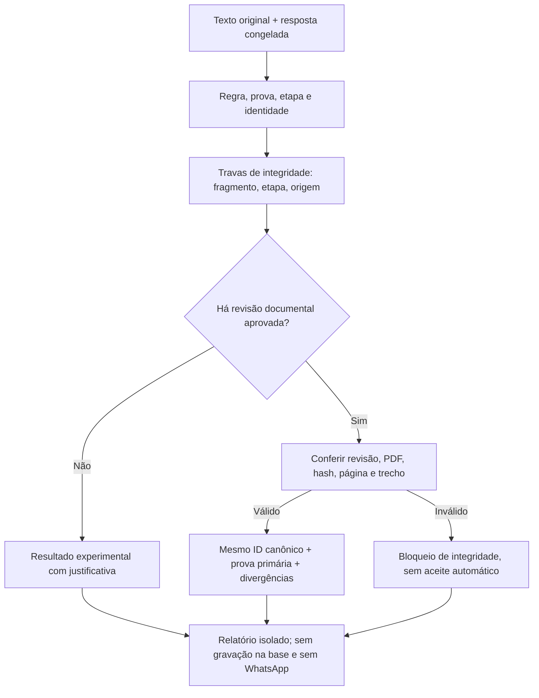

# Integração documental e amostra adicional — 16/10/2026

**Preparada e testada, não ativada.** Branch `test/original-triage-v7`. Nenhuma coleta, aplicação de decisões no catálogo ou chamada de WhatsApp nesta rodada. Não confundir código disponível na branch com política ativa no `main`.

## O que foi integrado

O resolvedor `src/lib/primary-evidence.mjs` reutiliza as revisões documentais já autorizadas. Confere revisão integral, selo do trecho, SHA-256 dos cinco PDFs, URL, página e citação literal. Divergência invalida a integração; não permite aceite silencioso pela IA. Preserva a avaliação anterior da notícia.

| Registro | Antes na simulação | Depois da integração |
| --- | --- | --- |
| Divinópolis / Mulheres das Gerais | Segunda notícia sem conclusão | Duplicata ligada ao fato existente: lei autoriza subscrever extinção; não prova extinção consumada |
| TCE 1214381 / CIMINAS | Segmento sem resultado suficiente | Referendo de cautelar; multa condicional não vira multa aplicada |
| TCE 1210770 / CIMINAS | Segmento sem resultado suficiente | Extinção do **processo**, sem mérito; multa de R$ 10 mil ao presidente, não ao consórcio |
| TCE 1217968 / CONSANE | Notícia informa 1217068 | Cautelar sustentada pelo acórdão; número e nome divergentes da notícia preservados |

São **quatro fatos canônicos já existentes**, não quatro novas inclusões. O vínculo CONSANE usa a associação editorial explicitamente aprovada, nunca similaridade entre números. Não foi localizada errata oficial.



## Medição

Reutilizados os 118 documentos anteriores e suas respostas congeladas. Selecionados mais 12 corpos do acervo, fora dos IDs e hashes anteriores, com semente fixa, diversidade de categorias e até dois por domínio. **Não são 12 novas coletas nem 12 fatos inéditos.** Seis tinham revisão editorial anterior. Referência preparada antes da chamada, não avaliação humana cega independente.

| Medida | Antes | Depois |
| --- | ---: | ---: |
| Aceitos nos 118 documentos-raiz | 64 | 64 |
| Descartados nos 118 | 51 | 51 |
| Publicações desdobradas | 2 | 2 |
| Pendência Divinópolis | 1 | 0 — ligada como duplicata |
| Segmentos antigos TCE sem resultado | 3 | 0 — três provas primárias |
| Amostra adicional: aceitos | 5 | 4 |
| Amostra adicional: descartados | 5 | 5 |
| Amostra adicional: exceções | 2 | 3 |

As duas publicações desdobradas são contadas como documentos-raiz, não como aceite genérico. Seus atos individuais têm resultados próprios. Nenhuma outra decisão dos 118 anteriores mudou.

### Por que aumentou uma exceção na amostra nova

- **CISMIV (`dcec74f9`)**: pendente → aceito. Eleição/recondução concluída, escolha unânime e identidade explícita no trecho principal da própria IA. Não equivale a posse no mandato futuro nem alteração de estatuto. A justificativa genérica da IA foi substituída por descrição limitada ao fato comprovado, preservando a resposta bruta.
- **CIMU (`b999516d`)**: aceito → pendente. A regra tratava de chamamento atual; a IA citou convênio de 2020. Categoria igual não resolve diferença de etapa/fato. A nova trava impede esse aceite. Próximo passo: separar a delegação histórica do chamamento, com provas próprias.
- **CNM/Conclima (`74fb6772`)**: aceito → pendente **na leitura experimental do original**. Título/URL dizem Santa Catarina; corpo diz Paraná. A composição já revisada com fonte alternativa não foi apagada ou alterada. Falta vincular corretamente a origem ao texto antes de usá-lo como original autônomo.
- **Cisa (`f5b8ae64`)**: permanece pendente. O corpo termina em palavra cortada, com 250 caracteres no arquivo original. Agora a trava é determinística, não depende de a IA perceber o corte. Recuperar íntegra; não descartar por ausência de texto. A referência prévia registrou 242 por engano; ela permanece congelada para auditoria, e a contagem correta é esta.

Restantes: dois textos do mesmo episódio de recomendação ao CISVP, acordo ABC/Metodista e eleição CISMIV aceitos; cinco rotinas de fornecedores/recrutamento descartadas. Aceites são publicações, **não necessariamente eventos novos**. Os dois CISVP precisam continuar consolidados no mesmo episódio pela deduplicação da produção.

Os rótulos finais concordam em 10/12 com a referência anterior, com zero falso aceite ou descarte **segundo essa referência limitada**. As duas retenções adicionais protegem etapa e proveniência; não são erros de descarte. Não transformar essa taxa em garantia de precisão para produção.

## Validação e execução

- 508 testes automatizados locais, incluindo integridade, ausência de ligação por aproximação, idempotência, eleições negadas/futuras, texto cortado, origem divergente e etapa sem prova.
- `npm run check`; pacote público do painel gerado localmente, sem publicar. Testes existentes continuam cobrindo evidência documental e bloqueio de reenvio diário/semanal.
- 12 chamadas novas de IA, 42.989 tokens de entrada e 3.777 de saída; zero erros de API. Repetição posterior usa respostas congeladas, sem mais custo de API.
- Primeira tentativa do workflow falhou **antes da API** por reconstrução de segmento sem `.text`. Corrigida com regressão no runner. Não foi falha de coleta ou de envio.
- [Execução com a amostra adicional](https://github.com/driano1221/radar-consorcios-whatsapp/actions/runs/38980125052) aprovada. [Validação final congelada](https://github.com/driano1221/radar-consorcios-whatsapp/actions/runs/38980852455), commit `9aa5945`: sucesso em testes, análise sintática, simulação, auditoria, pacote público e invariantes. Artefato baixado e comparado: os 130 resultados são idênticos aos locais, zero chamadas de IA no replay, zero chamadas de WhatsApp, produção desativada no experimento. Relatório final versionado vem deste runner Linux.
- `data/`, `state/` e `config/` preservados. Módulos novos não foram conectados ao coletor, catálogo ou remetente. Workflow final sem segredos de IA/WhatsApp e com permissão de leitura.

```sh
npm test
npm run check
npm run triage:simulate -- --validate
npm run triage:simulate -- --frozen
node scripts/audit-original-v7.mjs output/original-v7/report.json
npm run dashboard:build:public
```

`--ai` exige opção explícita e chave; não faz parte do workflow final. `--freeze` altera apenas a seleção de teste e não deve ser usado para reproduzir esta medição. Arquivos: `simulacao-v7-resultado.json` (respostas iniciais), `simulacao-v7-replay-resultado.json` (repetição), `simulacao-v7-referencia-previa.json` (referência anterior) e `simulacao-v7-amostra-nova.json` (seleção).

## Antes de ativar

Resolver os três casos retidos acima; repetir em amostra independente e validar deduplicação de episódios na conexão com a base. Só então apresentar ativação para aprovação. O radar atual não foi desligado nem teve sua agenda modificada; esta validação não é uma nova auditoria da saúde das coletas em produção.
